# Network Intrusion Detection with Suricata

**Author:** Wamba José · **Role:** SOC Analyst portfolio project · **Date:** November 2026

> I deployed Suricata 8.0.8 as a network IDS, wrote **8 custom detection rules**, attacked my own lab from Kali, and confirmed **8/8 detections**. I then tuned a noisy rule (**5,279 alerts → 1**) and used the same sensor to investigate a **real NetSupport RAT infection** from a public PCAP, identifying the victim host, user, initial download and C2 beacon.

   

---

##  Key results

| Metric | Result |
| --- | --- |
| Rules loaded | **53,578** (53,570 ET Open + 8 custom), 0 failed |
| Custom detections confirmed | **8 / 8** against live attacks |
| Noise reduction after tuning | **99.98%** (5,279 → 1 alert for one Nikto scan) |
| False positives found and explained | **3** (SSH via `nmap -sV`, SQLi via Nikto, SYN scan via Windows LDAP) |
| Real-world PCAP | 30,182 packets, **258 alerts**, infection fully reconstructed |

---

## Skills demonstrated

IDS deployment · Signature writing · Detection engineering & tuning · Alert triage · False-positive analysis · EVE JSON hunting with `jq` · Community ID pivoting · PCAP forensics · MITRE ATT&CK mapping · Linux networking troubleshooting

---

## Lab architecture

| VM | Role | IP | Notes |
| --- | --- | --- | --- |
| Ubuntu 26.04 (8 GB RAM) | Suricata sensor + target (SSH, Apache) | 10.0.20.10 | `enp0s3` monitored (promiscuous), `enp0s8` for internet |
| Kali Linux | Attacker | 10.0.20.20 | nmap, hydra, nikto, curl, dig, Python HTTP server |

- **Network:** VirtualBox NAT Network `SuricataLab` (10.0.20.0/24)
- **Mode:** IDS (passive), AF_PACKET capture, NIC offloading disabled
- **Ruleset:** Emerging Threats Open via `suricata-update` + [`rules/local.rules`](rules/local.rules)

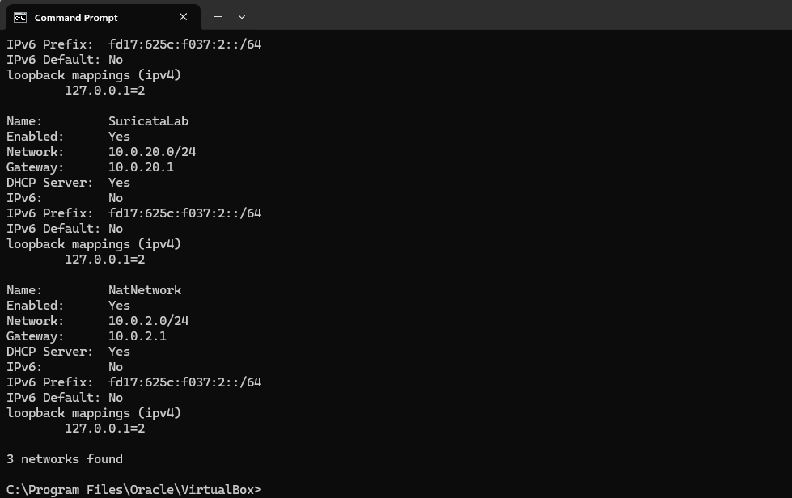

---

##  Setup summary

```bash
sudo add-apt-repository -y ppa:oisf/suricata-stable && sudo apt install -y suricata jq
sudo ethtool -K enp0s3 gro off lro off
# suricata.yaml: HOME_NET "[10.0.20.0/24]", af-packet interface enp0s3,
#                community-id: true, + /etc/suricata/rules/local.rules
sudo suricata-update enable-source et/open && sudo suricata-update
sudo suricata -T -c /etc/suricata/suricata.yaml -v
sudo systemctl restart suricata
```

Full config: [`configs/suricata.yaml`](configs/suricata.yaml)

| | |
| --- | --- |
| 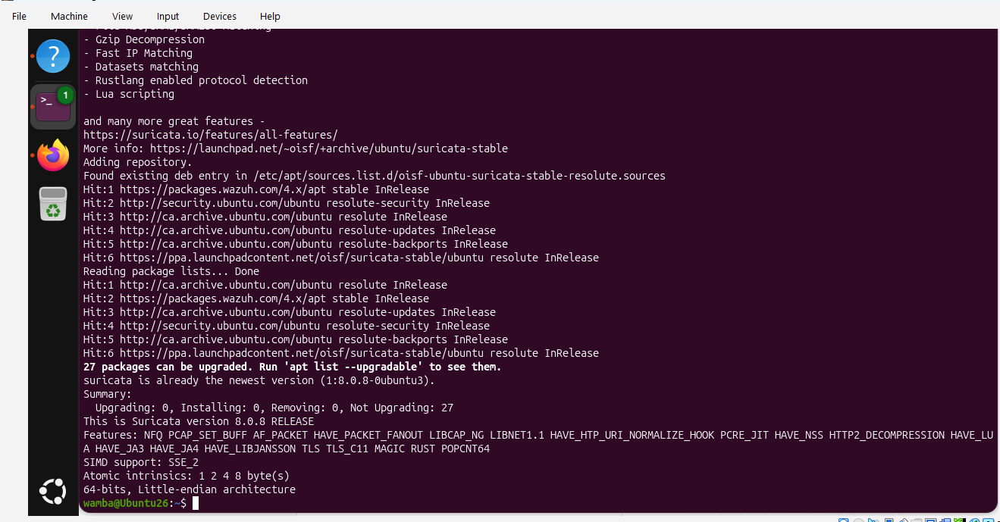 | 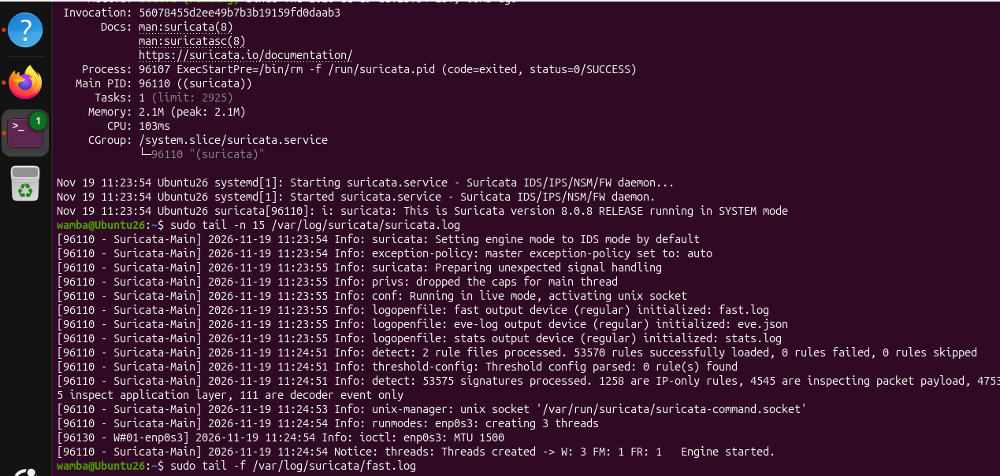 |

---

## Custom detection rules

| SID | Detects | Logic | MITRE ATT&CK |
| --- | --- | --- | --- |
| 1000001 | ICMP ping to sensor | `itype:8` | T1018 Remote System Discovery |
| 1000002 | Nmap SYN port scan | 20 SYNs / 10 s per source | T1046 Network Service Discovery |
| 1000003 | Nmap Scripting Engine probe | `http.user_agent` "Nmap Scripting Engine" | T1595 Active Scanning |
| 1000004 | SSH brute force | 5 SYNs to :22 / 60 s per source | T1110 Brute Force |
| 1000005 | Nikto web scanner | User-Agent "Nikto", 1 alert / 60 s (rev 2) | T1595.002 Vulnerability Scanning |
| 1000006 | SQL injection | "union" … "select" in decoded URI | T1190 Exploit Public-Facing Application |
| 1000007 | Suspicious DNS (.xyz) | `dns.query` ends with ".xyz" | T1071.004 Application Layer Protocol: DNS |
| 1000008 | EICAR malware test file | `file.data` contains EICAR string | T1105 Ingress Tool Transfer |

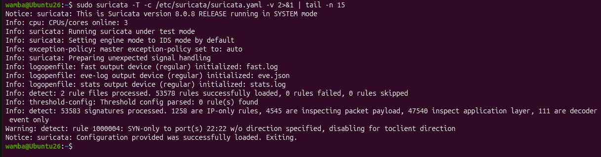

---

## Attack simulation & detections

| # | Attack from Kali | Detected by | Evidence |
| --- | --- | --- | --- |
| 1 | `ping -c 4 10.0.20.10` | 1000001 | [screenshot](12-attack1-icmp-detected.png) |
| 2 | `sudo nmap -sS -T4 10.0.20.10` | 1000002 | [screenshot](13-attack2-nmap-syn-detected.png) |
| 3 | `nmap -sV -sC -p 80 10.0.20.10` | 1000003 | [screenshot](14b-attack3-nmap-nse-detected.png) |
| 4 | `hydra -l testuser -P pass.txt ssh://10.0.20.10` | 1000004 | [screenshot](15b-attack4-ssh-bruteforce-detected.png) |
| 5 | `nikto -h http://10.0.20.10` | 1000005 | [screenshot](16c-attack5-nikto-detected.png) |
| 6 | `curl ".../index.php?id=1%20UNION%20SELECT..."` | 1000006 | [screenshot](17b-attack6-sqli-detected.png) |
| 7 | `dig malware-c2-test.xyz` | 1000007 | [screenshot](18b-attack7-dns-detected.png) |
| 8 | Download `eicar.com.txt` from Kali's Python server | 1000008 | [screenshot](19-attack8-eicar-detected.png) |

**Attack timeline (first hit per detection, from `eve.json`):**

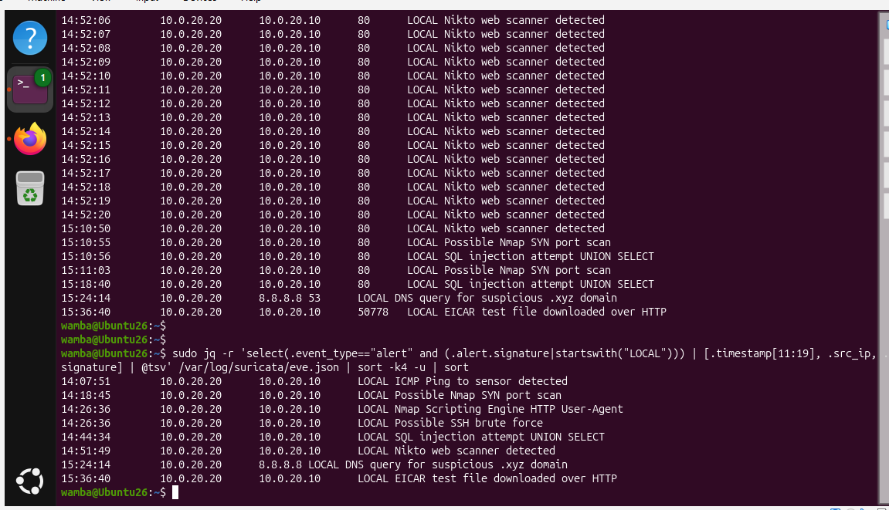

---

## Detection engineering: tuning & false positives

**1. Alert flood → tuned.** Rule 1000005 fired **5,279 times in 30 seconds** for a single Nikto scan. Adding `threshold:type limit, track by_src, count 1, seconds 60` reduced it to **1 actionable alert**, with no loss of detection.

| Before | After |
| --- | --- |
| 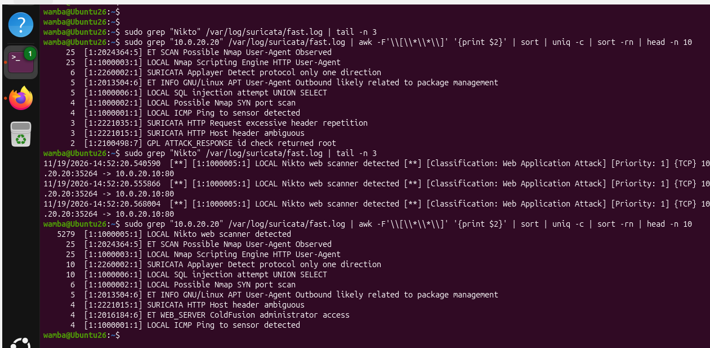 | 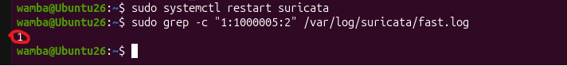 |

**2. False positive: SSH brute force.** The first SSH alert came from `nmap -sV` banner grabbing, not Hydra. Connection-count rules need host-log correlation (failed logins in `journalctl -u ssh`) to confirm.

**3. Signature evasion.** Nikto 2.6 no longer sends "Nikto" in its User-Agent by default, so rule 1000005 missed the first scan. A behaviour-based rule (many HTTP 404s from one source) would be more robust.

**4. Real-traffic false positive.** In the PCAP below, rule 1000002 fired on a Windows host's normal **LDAP (TCP/389)** traffic to its domain controller. Proposed fix: exclude DC service ports, `-> $HOME_NET ![53,88,135,389,445,636,3268]`.

---

## Threat hunting in EVE JSON

All queries: [`hunts/jq-queries.md`](hunts/jq-queries.md)

**Community ID pivot.** From one EICAR alert, the Community ID linked **5 events** of the same conversation: the HTTP request (`/eicar.com.txt`, curl, HTTP 200), 2 alerts (custom EICAR + ET Python SimpleHTTP server), the extracted file record and the flow summary.

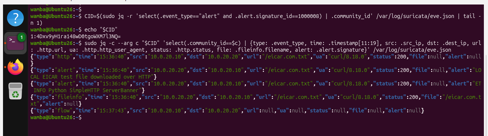

---

## Case study: NetSupport RAT infection (real PCAP)

**Source:** malware-traffic-analysis.net, 2026-11-10 exercise "The Lucky Turkey" (PCAP not included in this repo: it contains live malware).

```bash
sudo suricata -c /etc/suricata/suricata.yaml -r 2026-11-10-traffic-analysis-exercise.pcap \
  -l ~/pcap-lab/output -k none --set 'vars.address-groups.HOME_NET=[10.11.10.0/24]'
```

**Result:** 30,182 packets, 258 alerts. Summary: [`evidence/pcap-alert-summary.txt`](evidence/pcap-alert-summary.txt)

### Findings

| Item | Value |
| --- | --- |
| Infected host | **DESKTOP-5OMVI3L** (10.11.10.147) |
| User account | **edward.winslow** (from Kerberos) |
| Initial download | PowerShell → `vericheckusgo[.]com` (96.62.224[.]200), then a packed executable |
| Malware | **NetSupport RAT** (abused remote-admin tool) |
| C2 server | **93.152.209[.]36:443**, plain HTTP POST over port 443 |
| Beacon | Every **60 seconds**, 125 check-ins (~2 hours) |

### Incident timeline

| Time | Event |
| --- | --- |
| 13:20:14 | Victim logs on to the domain (LDAP to DC 10.11.10.10) |
| 13:21:50 | PowerShell downloads from vericheckusgo[.]com |
| 13:22:07 | First NetSupport RAT check-in to 93.152.209[.]36:443 |
| 13:22 → ~15:2x | Beacon every 60 s |

| | |
| --- | --- |
| 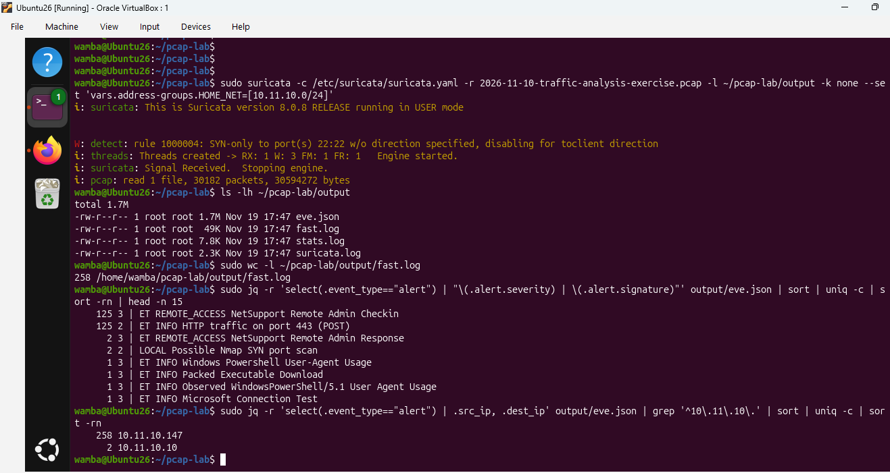 | 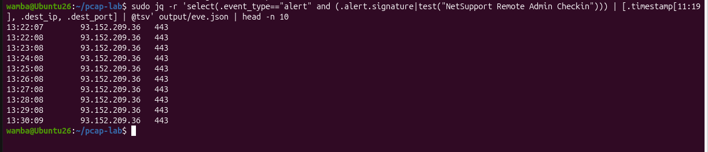 |
| 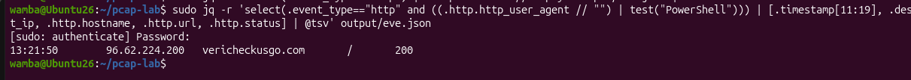 | 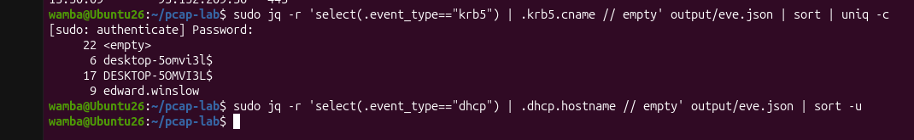 |

### MITRE ATT&CK (PCAP)

| Evidence | Technique |
| --- | --- |
| PowerShell User-Agent download | T1059.001 PowerShell |
| Packed executable download | T1105 Ingress Tool Transfer, T1027.002 Software Packing |
| NetSupport check-ins | T1219 Remote Access Software |
| HTTP POST beacons on port 443 | T1071.001 Web Protocols, T1571 Non-Standard Port |

### Recommended response

1. Isolate **DESKTOP-5OMVI3L** from the network.
2. Reset **edward.winslow**'s credentials and review recent logons.
3. Block `93.152.209[.]36`, `96.62.224[.]200` and `vericheckusgo[.]com` at the firewall/DNS.
4. Hunt for the same indicators and the 60-second beacon pattern on all other hosts.
5. Remove the NetSupport client and investigate how PowerShell was launched.

---

## Lessons learned

1. Untuned rules create alert floods; thresholds are part of the rule, not an afterthought.
2. Always triage the **first** alert: it may come from a different tool than expected.
3. Rules that are clean in a lab still need testing on real traffic.
4. User-Agent signatures are easy to evade; behaviour (rate, rhythm) is harder to fake.
5. When one data source is empty (DHCP), pivot to another (Kerberos).
6. A `suricata -T` config test does not update the running sensor.
7. All sensors and hosts need NTP; a 2-second drift already confuses timelines.

---

## Future improvements

- Forward `eve.json` to **Splunk / Wazuh** and build a detection dashboard
- Add **Zeek** alongside Suricata and correlate on Community ID
- Behaviour rules for 404 bursts and periodic beaconing
- Test **IPS mode** (NFQUEUE) to block, not just detect

---

## Repository structure

```
├── README.md
├── rules/local.rules             # 8 custom Suricata rules
├── configs/suricata.yaml         # sensor configuration
├── hunts/jq-queries.md           # all threat-hunting queries
├── evidence/lab-local-alerts.tsv # custom-rule alerts from the live lab
├── evidence/pcap-alert-summary.txt
└── *.png                         # 01–33 evidence screenshots (repo root)
```

> All attacks were performed in an isolated home lab against machines I own. The malware PCAP was analysed offline inside a VM and is not redistributed here.
